# 自习室预订系统

> 🎓 **计算机毕业设计 · 自习室预订系统**
>
> 本仓库只放**项目介绍 + 运行截图**（截图是站点带水印的原图，存在仓库 `images/` 里）。
>
> 👉 **完整可运行源码 / 数据库脚本 / 部署文档：[点我获取](https://geekcode.top/archives/%E8%87%AA%E4%B9%A0%E5%AE%A4%E9%A2%84%E8%AE%A2%E7%B3%BB%E7%BB%9F?utm_source=github)**
>
> 💬 咨询微信：**ir9372**　|　🌐 更多项目：[极客代码 geekcode.top](https://geekcode.top/?utm_source=github)
>
> 📌 项目详情页：<https://geekcode.top/archives/%E8%87%AA%E4%B9%A0%E5%AE%A4%E9%A2%84%E8%AE%A2%E7%B3%BB%E7%BB%9F?utm_source=github>

<table><td width="230" align="center"> <b>扫码加微信 ir9372</b></td><td valign="middle">📦 源码 = 项目介绍 + 全部运行截图 + 数据库 + 部署文档 👉 点上方任意截图，直接跳到 <b>极客代码 geekcode.top</b> 详情页</td></table>

---

<h1>自习室预订系统</h1>
<h2>项目概述</h2>

本项目为“自习室预订系统”，旨在解决高校或公共学习场所座位资源紧张、分配不均及管理效率低下的问题。系统采用前后端一体化架构，基于 Java 生态构建后端服务，结合 Vue 框架实现前端交互，通过 MyBatis-Plus 进行数据持久化操作，并集成 Apache Shiro 保障系统安全性。核心功能涵盖自习室信息管理、在线座位预订、公告发布、留言反馈及即时客服聊天等模块。该系统主要面向学生用户与系统管理员两类群体：学生可通过前台界面浏览自习室详情、查看公告、提交留言并进行座位预订；管理员则通过后台对自习室资源、用户信息、预订记录及系统配置进行全面管控。项目技术栈成熟稳定，具备良好的扩展性与维护性，适用于图书馆、共享办公空间或校园自习中心等场景，能够有效提升座位资源的利用率与管理透明度。

<h2>技术架构</h2>
<h3>1. 总体架构设计</h3>

本系统采用经典的 B/S（Browser/Server）架构模式，整体划分为表现层、业务逻辑层、数据访问层和数据库层。前端负责用户交互与视图渲染，后端提供 RESTful API 接口处理业务逻辑，数据库存储核心业务数据。

<a href="https://geekcode.top/archives/%E8%87%AA%E4%B9%A0%E5%AE%A4%E9%A2%84%E8%AE%A2%E7%B3%BB%E7%BB%9F?utm_source=github" title="查看完整源码">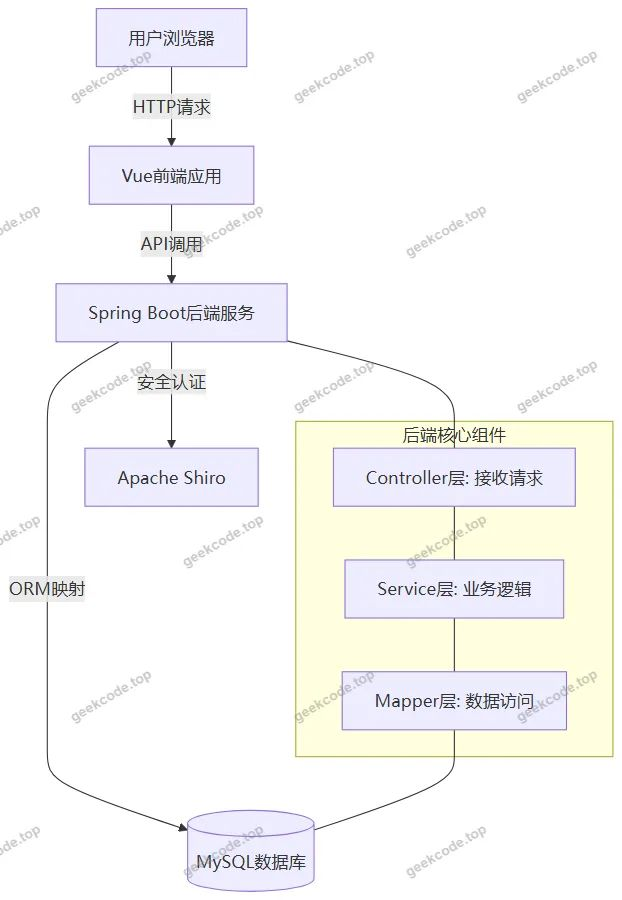</a>

<h3>2. 核心技术选型理由</h3>
<ul>
<li><strong>后端框架 (Spring Boot)</strong>：利用其自动配置特性简化开发流程，内置 Tomcat 服务器便于部署，社区生态丰富，能快速集成各类中间件。</li>
<li><strong>持久层框架 (MyBatis-Plus)</strong>：在 MyBatis 基础上增强 CRUD 操作能力，减少 XML 配置文件编写，支持 Lambda 表达式查询，提高代码可读性与开发效率。</li>
<li><strong>安全框架 (Apache Shiro)</strong>：轻量级且功能强大的安全框架，用于实现身份验证、授权管理、会话管理及加密功能，确保只有合法用户才能访问特定资源。</li>
<li><strong>数据库 (MySQL)</strong>：作为主流关系型数据库，具备高可靠性、高性能及广泛的支持度，适合存储结构化的用户信息、座位状态及预订记录。</li>
<li><strong>前端技术 (Vue.js)</strong>：虽然具体版本未在依赖中显式列出，但根据 <code>vue-integrated</code> 类型及路由描述，推测使用 Vue 全家桶（Vue Router, Vuex/Pinia），实现单页面应用（SPA）的高效渲染与状态管理。</li>
</ul>
<h3>3. 数据库设计要点</h3>

数据库设计遵循第三范式，主要包含以下核心实体表：

<ul>
<li><strong>用户表 (<code>user</code> / <code>xuesheng</code>)</strong>：存储学生基本信息、账号密码及角色标识。</li>
<li><strong>自习室表 (<code>zixishi</code>)</strong>：记录自习室名称、位置、总座位数、开放时间等属性。</li>
<li><strong>座位预订表 (<code>zuoweiyuding</code>)</strong>：关联用户与自习室，记录预订时间、座位号、状态（待审核、已确认、已完成、取消）。</li>
<li><strong>公告信息表 (<code>gonggaoxinxi</code>)</strong>：存储管理员发布的系统通知、规则说明等。</li>
<li><strong>留言反馈表 (<code>messages</code>)</strong>：记录用户对系统的使用反馈、投诉或建议。</li>
<li><strong>聊天记录表 (<code>chat</code>)</strong>：存储用户与客服之间的即时通讯消息。</li>
<li><strong>系统配置表 (<code>config</code>)</strong>：存储系统运行所需的动态参数。</li>
</ul>
<h2>功能模块</h2>
<h3>1. 前台用户端功能</h3>

前台界面主要服务于普通学生用户，提供便捷的信息获取与服务申请入口。

<ul>
<li><strong>首页展示</strong>：聚合展示最新公告、热门自习室推荐及快捷导航入口。</li>
<li><strong>用户认证</strong>：</li>
<li><strong>登录页</strong>：提供账号密码输入框，支持身份验证。</li>
<li><strong>注册页</strong>：允许新用户填写基本信息创建账户。</li>
<li><strong>公告信息</strong>：</li>
<li><strong>列表页</strong>：分页展示所有公告标题、发布时间及摘要。</li>
<li><strong>详情页</strong>：点击可查看公告全文内容。</li>
<li><strong>自习室服务</strong>：</li>
<li><strong>列表页</strong>：展示所有可用自习室的基本信息（名称、地点、剩余座位等）。</li>
<li><strong>详情页</strong>：查看特定自习室的详细规则、设施介绍及实时座位状态。</li>
<li><strong>座位预订</strong>：</li>
<li><strong>预订列表</strong>：用户查看自己历史及当前的座位预订记录。</li>
<li><strong>预订详情</strong>：查看单次预订的具体信息，包括时间、座位号及状态。</li>
<li><strong>留言反馈</strong>：</li>
<li><strong>列表页</strong>：展示用户提交的留言及其回复状态。</li>
<li><strong>个人中心</strong>：</li>
<li>修改个人基本资料、查看账户安全设置。</li>
<li><strong>客服聊天</strong>：</li>
<li>提供即时通讯窗口，用户可在此咨询自习室相关问题，与后台客服进行实时对话。</li>
</ul>
<h3>2. 后台管理端功能</h3>

后台界面供管理员使用，实现对系统全局数据的监控与维护。

<ul>
<li><strong>系统登录</strong>：管理员专属入口，需通过身份验证方可进入。</li>
<li><strong>首页仪表盘</strong>：展示关键数据统计概览（如今日预订量、活跃用户数等，具体取决于实现细节）。</li>
<li><strong>自习室管理 (<code>/zixishi</code>)</strong>：</li>
<li>增删改查自习室基础信息。</li>
<li>设置自习室开放时间及最大容纳人数。</li>
<li><strong>座位预订管理 (<code>/zuoweiyuding</code>)</strong>：</li>
<li>查看所有用户的预订记录。</li>
<li>审核、驳回或取消异常预订订单。</li>
<li>手动调整座位占用情况。</li>
<li><strong>学生管理 (<code>/xuesheng</code>)</strong>：</li>
<li>查看注册用户列表。</li>
<li>重置用户密码、禁用违规账号或删除无效用户。</li>
<li><strong>公告信息管理 (<code>/gonggaoxinxi</code>)</strong>：</li>
<li>发布新公告。</li>
<li>编辑、删除已有公告。</li>
<li><strong>留言板管理 (<code>/messages</code>)</strong>：</li>
<li>查看用户提交的留言反馈。</li>
<li>回复用户留言，处理投诉与建议。</li>
<li><strong>客服管理 (<code>/chat</code>)</strong>：</li>
<li>实时监控聊天会话。</li>
<li>回复用户咨询，结束会话。</li>
<li><strong>配置文件管理 (<code>/config</code>)</strong>：</li>
<li>修改系统全局参数，如网站名称、Logo、联系方式等。</li>
</ul>
<h2>用户角色与权限</h2>

本系统基于 Apache Shiro 实现细粒度的权限控制，主要划分两种角色：

<h3>1. 普通用户（学生）</h3>
<ul>
<li><strong>身份标识</strong>：通过前台注册获得账号。</li>
<li><strong>权限范围</strong>：</li>
<li><strong>只读权限</strong>：浏览公告、查看自习室列表及详情、查看自己的预订记录和留言。</li>
<li><strong>写权限</strong>：提交座位预订申请、发送留言反馈、发起客服聊天、修改个人信息。</li>
<li><strong>限制</strong>：无法访问后台管理系统，无法查看其他用户的隐私数据，无法修改系统配置或他人数据。</li>
</ul>
<h3>2. 管理员</h3>
<ul>
<li><strong>身份标识</strong>：由系统预设或超级管理员创建，拥有最高权限。</li>
<li><strong>权限范围</strong>：</li>
<li><strong>全量数据访问</strong>：可查看所有用户信息、所有预订记录、所有留言及聊天历史。</li>
<li><strong>CRUD 操作</strong>：对自习室、公告、用户、预订记录等进行完整的增加、删除、修改和查询操作。</li>
<li><strong>系统配置</strong>：有权修改系统底层配置参数。</li>
<li><strong>业务审批</strong>：拥有对座位预订的审核权和对用户留言的回复权。</li>
</ul>
<h2>项目特色与创新点</h2>
<ol>
<li><strong>闭环的服务体验</strong>：不仅实现了核心的“预订”功能，还集成了“公告通知”、“留言反馈”和“在线客服”三大辅助模块。用户在预订过程中遇到问题可直接联系客服，预订后的疑问可通过留言区互动，形成了从信息发布到服务执行的完整闭环。</li>
<li><strong>实时沟通机制</strong>：引入 <code>ChatController</code> 及相关前端聊天界面，打破了传统管理系统静态表单交互的局限，提供了类似 IM 软件的实时问答能力，显著提升了用户咨询效率和满意度。</li>
<li><strong>安全与规范并重</strong>：集成 Apache Shiro 框架，确保了用户身份认证的安全性和接口调用的合法性，防止未授权访问和数据篡改，符合企业级应用的安全标准。</li>
<li><strong>高效的数据交互</strong>：采用 MyBatis-Plus 优化数据库操作，配合 Spring Boot 的高性能 Web 容器，使得系统在并发访问自习室列表和提交预订时能保持较低的响应延迟。</li>
<li><strong>模块化后台设计</strong>：后台路由清晰分离了资源管理（自习室）、业务流程（预订）、用户运营（学生、留言）和系统维护（配置、公告），便于后续功能的独立迭代和维护。</li>
</ol>
<h2>部署环境</h2>

为确保系统正常运行，需准备以下软硬件环境：

<h3>1. 硬件要求</h3>
<ul>
<li><strong>CPU</strong>：Intel Core i5 及以上或同等性能处理器。</li>
<li><strong>内存</strong>：至少 8GB RAM（推荐 16GB 以应对多任务处理）。</li>
<li><strong>硬盘</strong>：至少 20GB 可用空间，建议使用 SSD 以提高数据库读写速度。</li>
</ul>
<h3>2. 软件环境</h3>
<ul>
<li><strong>操作系统</strong>：Windows 10/11, Linux (CentOS 7+, Ubuntu 20.04+), macOS。</li>
<li><strong>JDK 版本</strong>：Java Development Kit 1.8 或更高版本（推荐 JDK 1.8 LTS 版本以保证兼容性）。</li>
<li><strong>数据库</strong>：MySQL 5.7 或 MySQL 8.0。需安装 MySQL Server 并创建对应数据库实例。</li>
<li><strong>构建工具</strong>：Maven 3.6+（用于后端依赖管理和打包）。</li>
<li><strong>Node.js</strong>：LTS 版本（如 v14.x 或 v16.x），用于前端 Vue 项目的依赖安装和本地开发服务器启动。</li>
<li><strong>Web 服务器</strong>：Nginx（可选，用于生产环境反向代理和静态资源托管）或 Tomcat（若未内嵌）。</li>
<li><strong>浏览器</strong>：Chrome, Edge, Firefox 等现代主流浏览器。</li>
</ul>
<h3>3. 部署步骤简述</h3>
<ol>
<li><strong>数据库初始化</strong>：导入 SQL 脚本创建表结构和初始数据。</li>
<li><strong>后端部署</strong>：修改 <code>application.yml</code> 中的数据库连接信息，使用 Maven 打包生成 jar 文件，通过 <code>java -jar</code> 命令启动服务。</li>
<li><strong>前端部署</strong>：进入前端目录，执行 <code>npm install</code> 安装依赖，执行 <code>npm run build</code> 编译静态资源，将生成的 <code>dist</code> 文件夹部署至 Nginx 或 Spring Boot 的静态资源目录下。</li>
</ol>
<h2>五、技术特性</h2>
<ul>
<li>前后端集成部署，前端资源打包至后端 static 目录</li>
<li>使用 MyBatis-Plus 简化数据访问层开发</li>
<li>集成 Shiro 权限框架实现角色权限控制</li>
</ul>
<h2>六、功能模块截图</h2>
<h3>前台用户端</h3>
<h4>前台首页</h4>

<a href="https://geekcode.top/archives/%E8%87%AA%E4%B9%A0%E5%AE%A4%E9%A2%84%E8%AE%A2%E7%B3%BB%E7%BB%9F?utm_source=github" title="查看完整源码">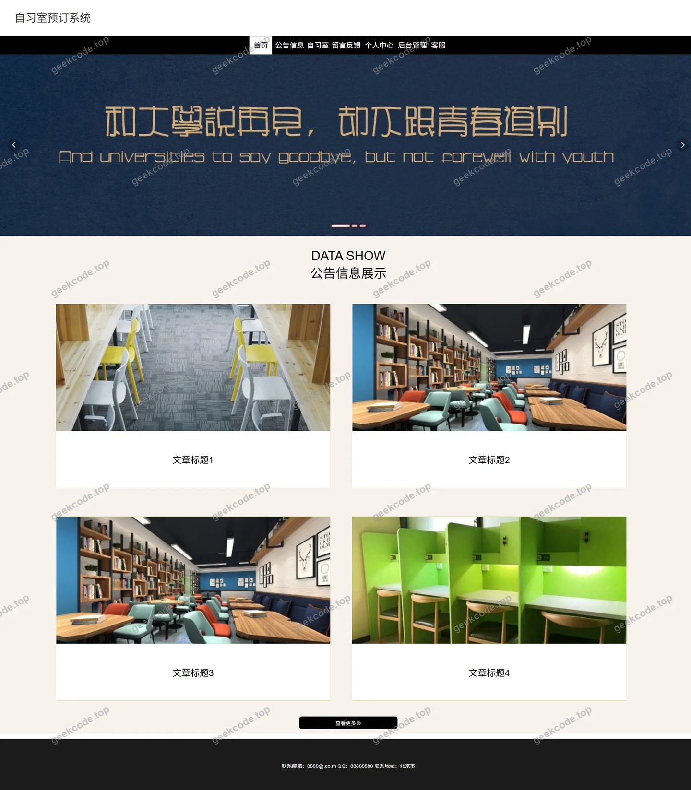</a>

<h4>前台登录页</h4>

<h4>前台注册页</h4>

<h4>前台-公告信息列表</h4>

<a href="https://geekcode.top/archives/%E8%87%AA%E4%B9%A0%E5%AE%A4%E9%A2%84%E8%AE%A2%E7%B3%BB%E7%BB%9F?utm_source=github" title="查看完整源码">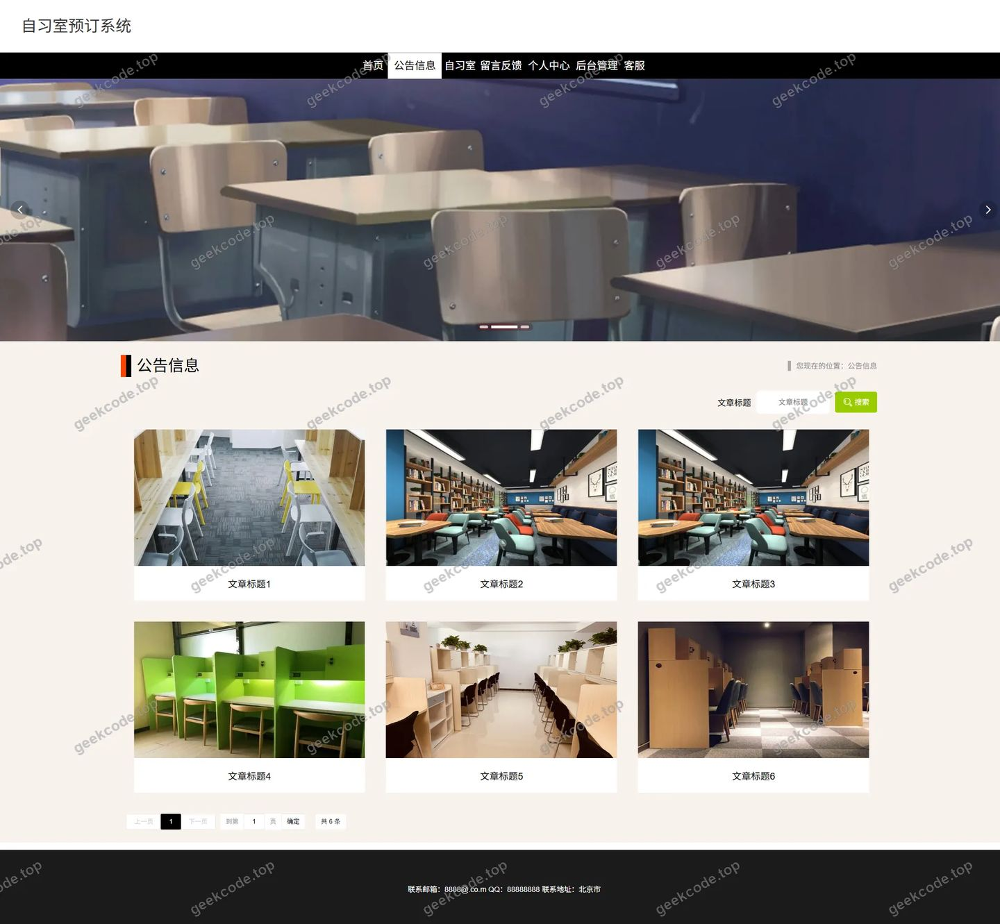</a>

<h4>前台-自习室列表</h4>

<a href="https://geekcode.top/archives/%E8%87%AA%E4%B9%A0%E5%AE%A4%E9%A2%84%E8%AE%A2%E7%B3%BB%E7%BB%9F?utm_source=github" title="查看完整源码">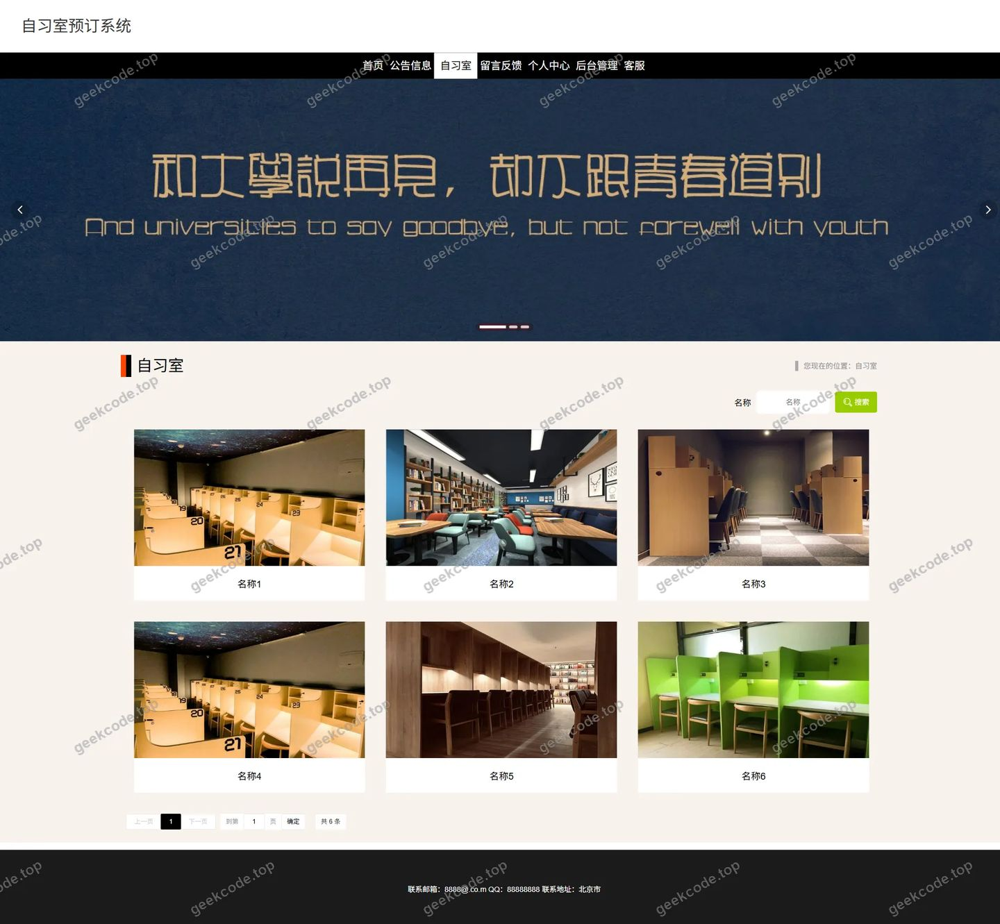</a>

<h4>前台个人中心</h4>

<a href="https://geekcode.top/archives/%E8%87%AA%E4%B9%A0%E5%AE%A4%E9%A2%84%E8%AE%A2%E7%B3%BB%E7%BB%9F?utm_source=github" title="查看完整源码">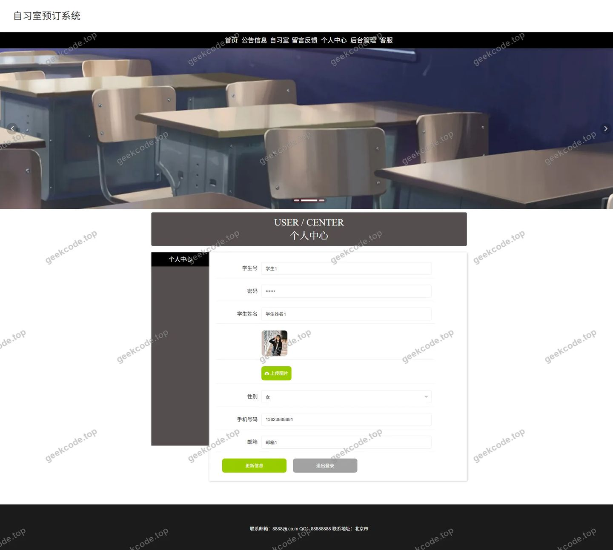</a>

<h4>前台-留言反馈列表</h4>

<a href="https://geekcode.top/archives/%E8%87%AA%E4%B9%A0%E5%AE%A4%E9%A2%84%E8%AE%A2%E7%B3%BB%E7%BB%9F?utm_source=github" title="查看完整源码">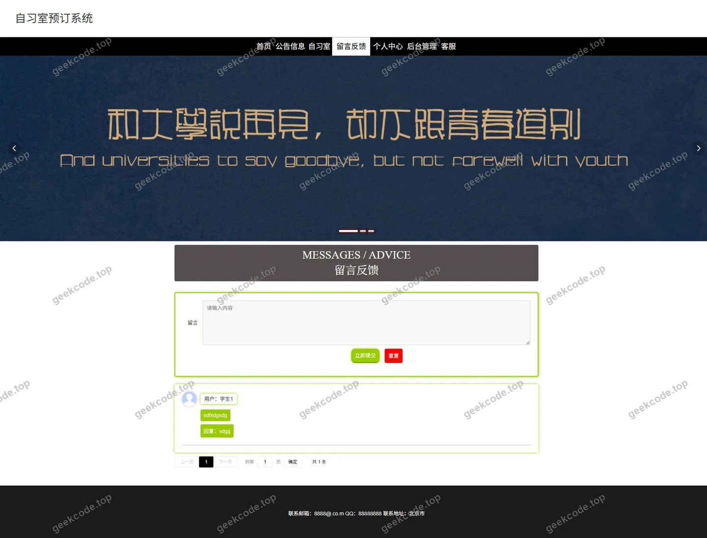</a>

<h4>前台-公告信息-详情</h4>

<a href="https://geekcode.top/archives/%E8%87%AA%E4%B9%A0%E5%AE%A4%E9%A2%84%E8%AE%A2%E7%B3%BB%E7%BB%9F?utm_source=github" title="查看完整源码">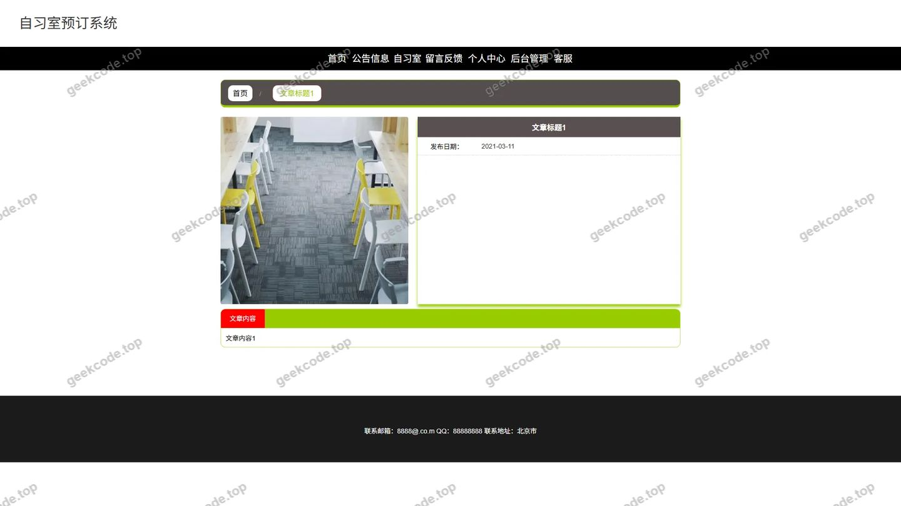</a>

<h4>前台-自习室-详情</h4>

<a href="https://geekcode.top/archives/%E8%87%AA%E4%B9%A0%E5%AE%A4%E9%A2%84%E8%AE%A2%E7%B3%BB%E7%BB%9F?utm_source=github" title="查看完整源码">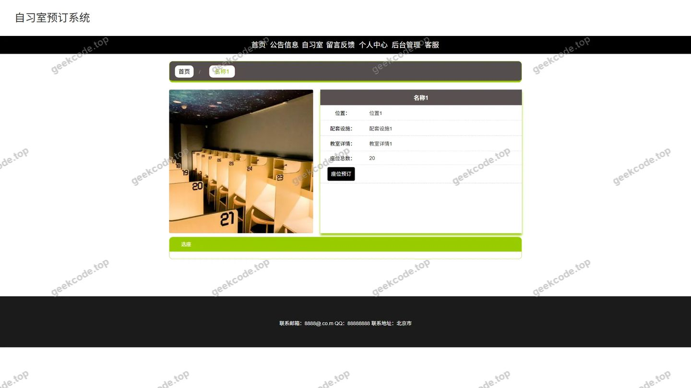</a>

<h4>前台-座位预订列表</h4>

<h4>前台-座位预订-详情</h4>

<a href="https://geekcode.top/archives/%E8%87%AA%E4%B9%A0%E5%AE%A4%E9%A2%84%E8%AE%A2%E7%B3%BB%E7%BB%9F?utm_source=github" title="查看完整源码">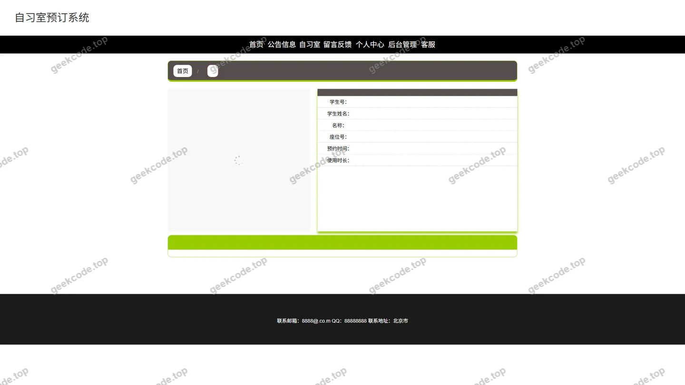</a>

<h4>前台-客服聊天</h4>

<a href="https://geekcode.top/archives/%E8%87%AA%E4%B9%A0%E5%AE%A4%E9%A2%84%E8%AE%A2%E7%B3%BB%E7%BB%9F?utm_source=github" title="查看完整源码">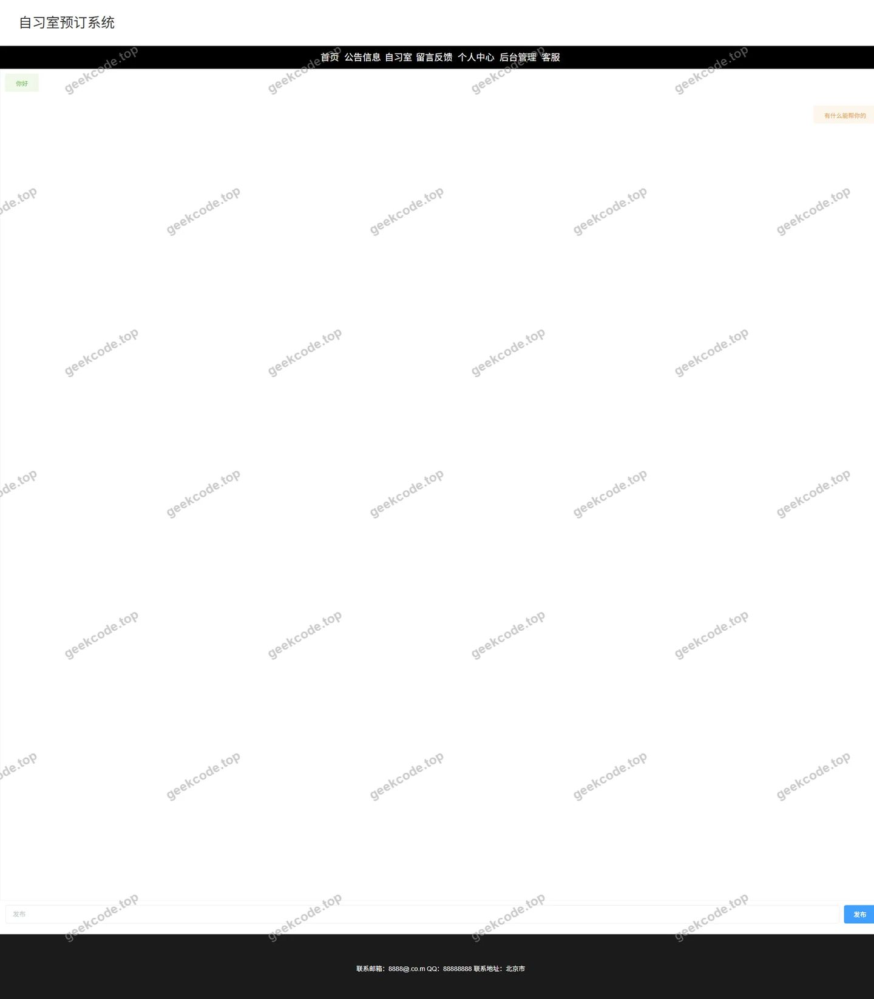</a>

<h3>后台管理端</h3>
<h4>后台-在线客服</h4>

<a href="https://geekcode.top/archives/%E8%87%AA%E4%B9%A0%E5%AE%A4%E9%A2%84%E8%AE%A2%E7%B3%BB%E7%BB%9F?utm_source=github" title="查看完整源码">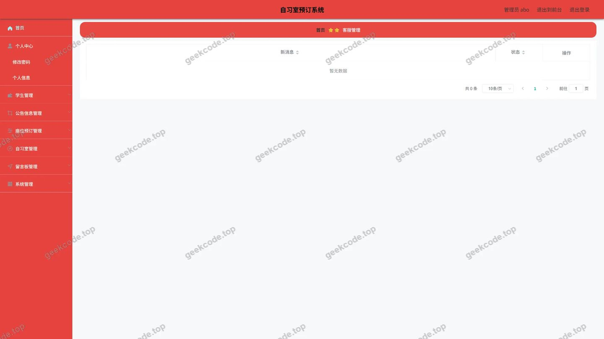</a>

<h4>后台-系统配置</h4>

<a href="https://geekcode.top/archives/%E8%87%AA%E4%B9%A0%E5%AE%A4%E9%A2%84%E8%AE%A2%E7%B3%BB%E7%BB%9F?utm_source=github" title="查看完整源码">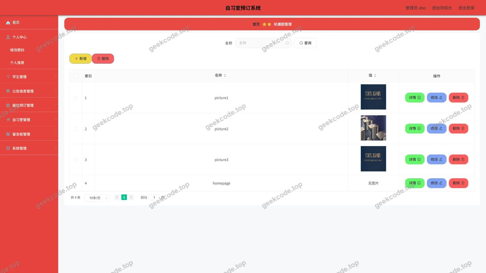</a>

<h4>后台-公告信息</h4>

<a href="https://geekcode.top/archives/%E8%87%AA%E4%B9%A0%E5%AE%A4%E9%A2%84%E8%AE%A2%E7%B3%BB%E7%BB%9F?utm_source=github" title="查看完整源码">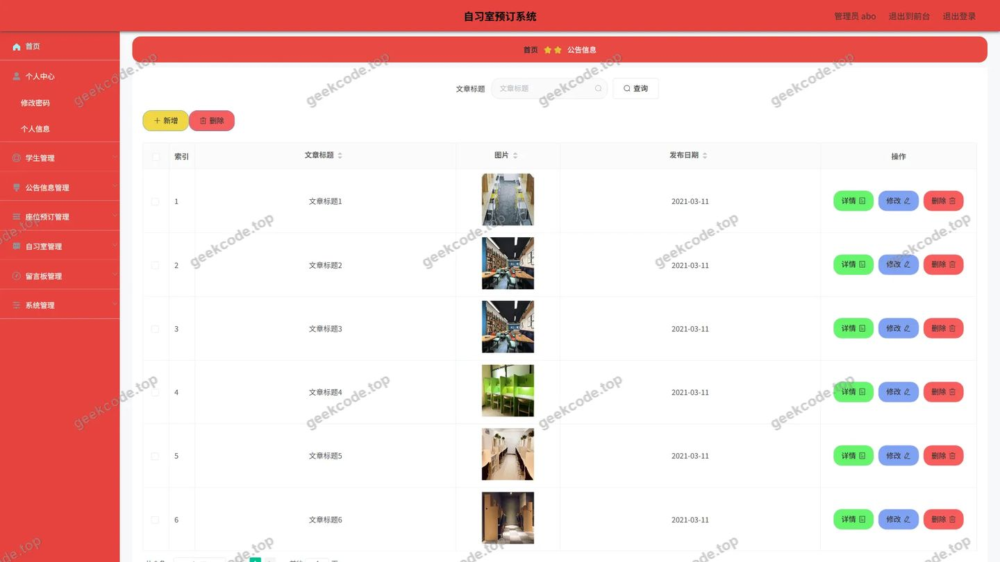</a>

<h4>后台首页</h4>

<a href="https://geekcode.top/archives/%E8%87%AA%E4%B9%A0%E5%AE%A4%E9%A2%84%E8%AE%A2%E7%B3%BB%E7%BB%9F?utm_source=github" title="查看完整源码">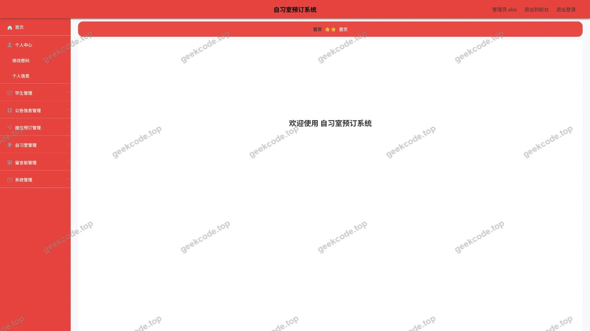</a>

<h4>后台-登录</h4>

<h4>后台-留言板</h4>

<a href="https://geekcode.top/archives/%E8%87%AA%E4%B9%A0%E5%AE%A4%E9%A2%84%E8%AE%A2%E7%B3%BB%E7%BB%9F?utm_source=github" title="查看完整源码">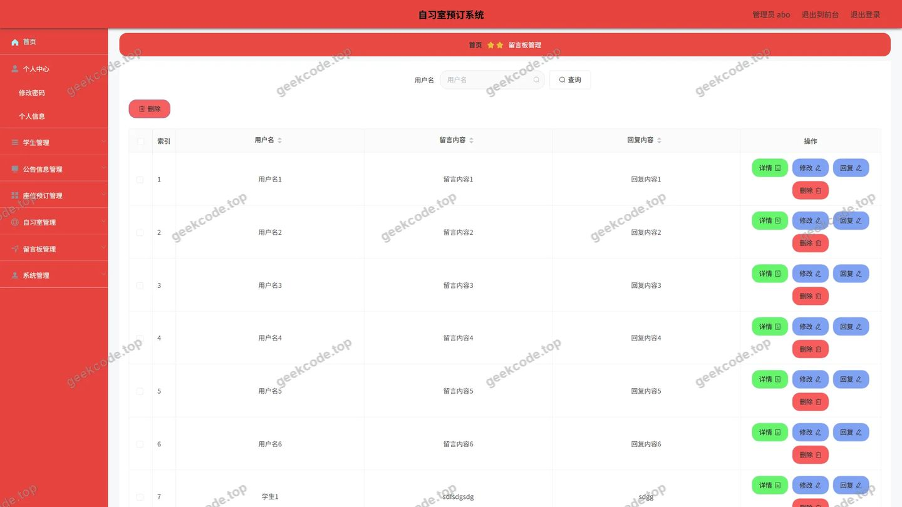</a>

<h4>后台-学生</h4>

<a href="https://geekcode.top/archives/%E8%87%AA%E4%B9%A0%E5%AE%A4%E9%A2%84%E8%AE%A2%E7%B3%BB%E7%BB%9F?utm_source=github" title="查看完整源码">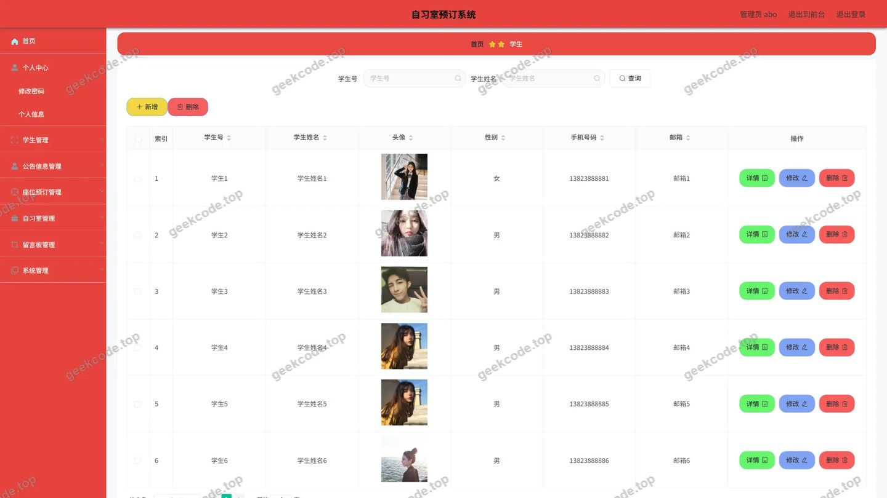</a>

<h4>后台-自习室</h4>

<a href="https://geekcode.top/archives/%E8%87%AA%E4%B9%A0%E5%AE%A4%E9%A2%84%E8%AE%A2%E7%B3%BB%E7%BB%9F?utm_source=github" title="查看完整源码">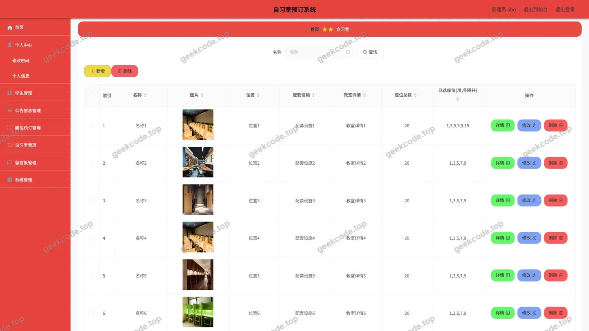</a>

<h4>后台-座位预订</h4>

<a href="https://geekcode.top/archives/%E8%87%AA%E4%B9%A0%E5%AE%A4%E9%A2%84%E8%AE%A2%E7%B3%BB%E7%BB%9F?utm_source=github" title="查看完整源码">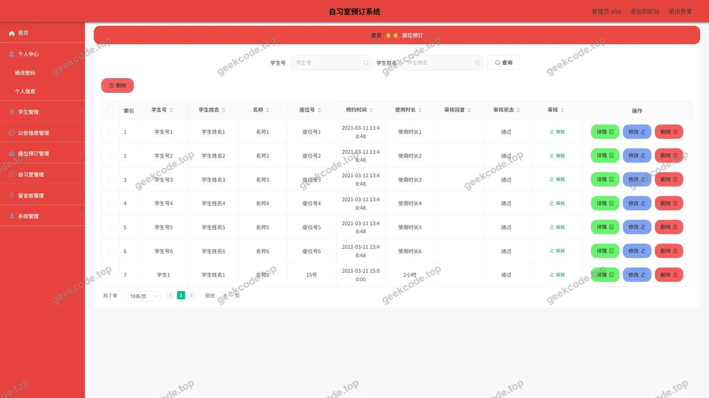</a>

---

## 获取完整源码

| 项目 | 说明 |
| --- | --- |
| 项目名 | 自习室预订系统 |
| 运行截图 | 本文 22 张（站点带水印原图，仓库 `images/` 目录） |
| 完整源码 | [https://geekcode.top/archives/%E8%87%AA%E4%B9%A0%E5%AE%A4%E9%A2%84%E8%AE%A2%E7%B3%BB%E7%BB%9F?utm_source=github](https://geekcode.top/archives/%E8%87%AA%E4%B9%A0%E5%AE%A4%E9%A2%84%E8%AE%A2%E7%B3%BB%E7%BB%9F?utm_source=github) |
| 咨询微信 | **ir9372**（备注：jingpin-yuanma） |
| 更多项目 | [极客代码 geekcode.top](https://geekcode.top/?utm_source=github) |

> 需要源码、部署、改配置、跑不起来等问题，加微信 ir9372 沟通，说明项目名即可。
